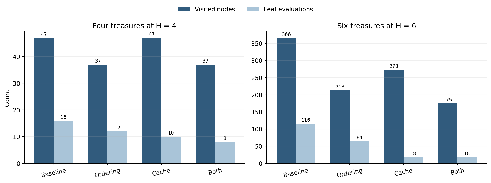
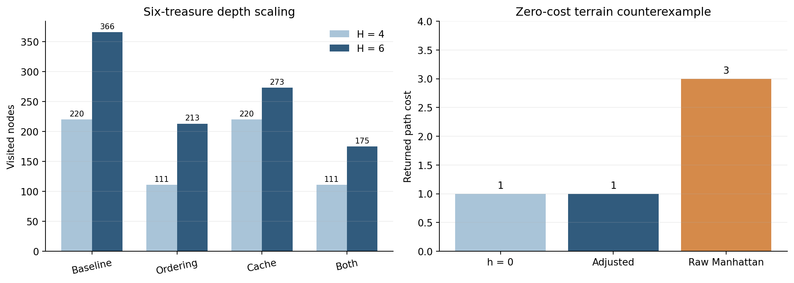

# 当代人工智能实验课 实验二搜索算法实验报告 完整版

姓名：颜欣然　学号：10224804401　日期：2026 年 11 月 11 日

github链接：https://github.com/xiye615/ai_lab2

## 1 算法设计与实验设置

| 算法 | 状态与代价 | 实现方法 |
|---|---|---|
| A* | 网格坐标；代价为步数或进入格权值 | 最小堆按 $f=g+h$ 排序；`g_score` 保存最优代价，父节点表恢复路径，跳过过期条目 |
| Minimax | 树节点或博弈状态 | MAX 取最大子值，MIN 取最小子值 |
| Alpha-Beta | 与 Minimax 相同 | 维护 $\alpha$、$\beta$，当 $\alpha\ge\beta$ 且仍有未访问分支时剪枝 |
| 综合题 | 双方位置、剩余宝藏、累计收益、当前玩家 | 先计算距离矩阵；按 $Gain=V_i-d(p,T_i)$ 更新状态，以 $U=Score_A-Score_B$ 评价 |

实现时，我先用 Minimax 得到不剪枝的基准，再加入 Alpha-Beta，以确认剪枝只改变开销而不改变结果。A* 使用同一搜索核心，通过替换代价函数和启发函数处理普通地图、加权地图和距离矩阵。环境为 Python 3.10.11；每种配置运行 50 或 100 次。16 个自动测试覆盖给定输出、无解情况、优化一致性和拓展场景。

## 2 题目一迷宫寻路

每个可通行格是一个状态，四方向移动代价均为 1。程序返回 `(0,0)→(0,1)→(0,2)→(1,2)→(1,3)→(1,4)→(2,4)→(3,4)`，共 7 步；无路时返回空列表。

| 启发函数 | 路径代价 | 展开节点 | 生成节点 | 时间 ms |
|---|---:|---:|---:|---:|
| h=0 | 7 | 16 | 17 | 0.0645 |
| 曼哈顿距离 | 7 | 8 | 11 | 0.0354 |

两种方法得到相同最短路径。曼哈顿距离在四方向单位代价下可采纳且一致，并将展开节点减少 50%；它优先处理接近终点的状态，减少了无关方向的扩展。

## 3 题目二加权地形

移动到相邻格的代价等于该格权值，进入 E 的代价为 0。最优路径为 `(0,0)→(1,0)→(2,0)→(3,0)→(3,1)→(3,2)→(4,2)→(4,3)→(4,4)`；七个普通格各计 1，最后进入 E 计 0，总代价为 7。

考虑到最后一步免费，我发现普通曼哈顿距离在 E 的相邻格会高估代价。设最小普通地形代价为 $c_{min}$，因此改用 $h=\max(Manhattan-1,0)c_{min}$。

| 启发函数 | 最小代价 | 展开节点 | 生成节点 | 时间 ms |
|---|---:|---:|---:|---:|
| h=0 | 7 | 15 | 24 | 0.0839 |
| 修正曼哈顿 | 7 | 11 | 19 | 0.0690 |
| 普通曼哈顿 | 7 | 11 | 19 | 0.0633 |

修正启发函数比 `h=0` 少展开 4 个节点并保留最优性。普通曼哈顿在该样例上也返回 7，但单个样例正确不能证明其适用于其他代价分布。

## 4 题目三 Alpha-Beta 剪枝

三个底层 MAX 节点回传 5、9、2，上一层 MIN 节点回传 5、2，根节点最终取 5。Minimax 和 Alpha-Beta 的结果一致。

| 方法 | 访问节点 | 叶节点 | 剪去分支 | 时间 ms |
|---|---:|---:|---:|---:|
| Minimax 左到右 | 15 | 8 | 0 | 0.0313 |
| Alpha-Beta 左到右 | 14 | 7 | 1 | 0.0352 |
| Alpha-Beta 理论最佳 | 11 | 5 | 2 | 0.0569 |
| Alpha-Beta 理论最差 | 15 | 8 | 0 | 0.0638 |

最佳顺序较早建立紧边界，因此只访问 11 个节点；最差顺序无法提前排除分支。理论最佳顺序需要预知子树值，只用于展示剪枝上界，不是实际应用中的免费优化。

## 5 题目四竞争环境下的宝藏分配

博弈状态记录 `(A位置, B位置, 剩余宝藏, Score_A, Score_B, 当前玩家)`。A 最大化 $U$，B 最小化 $U$。A* 得到的距离矩阵如下。

| 起点 终点 | A | B | T1 | T2 | T3 | T4 |
|---|---:|---:|---:|---:|---:|---:|
| A | 0 | 12 | 10 | 4 | 8 | 8 |
| B | 12 | 0 | 8 | 8 | 4 | 10 |
| T1 | 10 | 8 | 0 | 6 | 6 | 12 |
| T2 | 4 | 8 | 6 | 0 | 6 | 6 |
| T3 | 8 | 4 | 6 | 6 | 0 | 6 |
| T4 | 8 | 10 | 12 | 6 | 6 | 0 |

| 深度 | Minimax 首步 值 | Minimax 节点 | Alpha-Beta 节点 | 剪去分支 |
|---:|---|---:|---:|---:|
| H=2 | T2，-1 | 17 | 13 | 4 |
| H=4 | T3，3 | 65 | 47 | 6 |

H=2 的主变化为 `A→T2, B→T3`，双方收益为 2、3，故 $U=-1$。H=4 的主变化为 `A→T3, B→T1, A→T2, B→T4`，各步收益为 -1、1、0、-5，故 $U=3$。经过对比，我发现首步变化不是由即时价值决定的；完整深度还会考虑当前位置对后续移动代价的影响。

## 6 自设改进与拓展实验

### 6.1 节点排序与置换表

我先尝试按一步收益排序：MAX 优先访问较高 $U$，MIN 优先访问较低 $U$。随后加入置换表，键为 `(双方位置, 剩余宝藏, 当前玩家, 剩余深度)`，缓存相对当前 $U$ 的未来增量。表项使用 `EXACT`、`LOWER`、`UPPER` 标记，避免把剪枝边界当作精确值。

| 四宝藏 H=4 | 访问节点 | 叶节点评估 | 缓存命中 | 剪去分支 |
|---|---:|---:|---:|---:|
| 基础 Alpha-Beta | 47 | 16 | 0 | 6 |
| 仅收益排序 | 37 | 12 | 0 | 8 |
| 仅缓存 | 47 | 10 | 6 | 6 |
| 排序加缓存 | 37 | 8 | 4 | 8 |

排序主要减少进入的分支，缓存主要减少重复求值；组合后叶节点评估从 16 降到 8。

<p align="center"></p>

节点减少没有在当前实验中直接转化为更短时间，因为总耗时仍为毫秒量级，排序、哈希和表项管理的固定成本占比较高。缓存单独使用时命中更多；加入排序后，部分重复分支已经被剪去，命中数反而下降。因此这两项改进作用在不同位置，组合后搜索规模最小，但不保证在小输入上立刻缩短时间。

### 6.2 六宝藏与零代价反例

考虑到四宝藏规模较小，我将场景扩展为 9×9 开放地图和六个宝藏。H=6 时所有配置均选择 T2、最优值为 6；排序加缓存把访问节点从 366 降到 175，叶节点评估从 116 降到 18。

为了验证启发函数的适用条件，我又构造 `[[S,1,1],[1,4,1],[0,0,E]]`。`h=0` 与修正启发函数沿底部返回代价 1，普通曼哈顿返回代价 3。当 $c_{min}=0$ 时，修正公式自动退化为 `h=0`，而基于单位步数的曼哈顿距离可能破坏最优性。

<p align="center"></p>

六宝藏实验扩大了分支数，使排序和缓存的作用比四宝藏场景更明显；零代价反例则说明启发函数的有效性依赖代价下界。两组实验分别考察了规模瓶颈和特殊代价条件，不能只根据给定样例判断算法在其他输入上的表现。

## 7 结论与复现

A*、Minimax、Alpha-Beta 和综合题均通过给定测试。实验表明，启发函数必须匹配真实代价，较好的访问顺序能提高剪枝效率，置换表适合复用重复局面。六宝藏实验和零代价反例进一步说明了优化收益与适用条件。

复现命令：

```powershell
python -m unittest discover -s tests -v
python experiments/run_baseline.py
python experiments/run_enhancements.py
python experiments/generate_complete_figures.py
```
